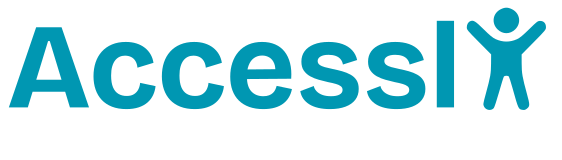

<p align="center">
  <picture>
    <source media="(prefers-color-scheme: dark)" srcset="public/brand/accessly-wordmark-web-dark.svg">
    
  </picture>
</p>

<p align="center"><strong>Know before you go. Ask for what you need, without explaining why.</strong></p>

<p align="center">
  <a href="https://www.access-for-all.us/">Live demo: www.access-for-all.us</a>
  · HackUMass XIV (Nov 2026)
  · Public Good: Best Accessibility Hack · Gemini API · MongoDB Atlas · Vultr
</p>

---

## The problem

Most event pages handle accessibility with a single line: *"For accessibility inquiries, email…"*.

To find out whether there's an elevator, a disabled student has to find a contact, write an email, explain their situation, and often **disclose a disability** to a stranger, then wait and hope for a reply before deciding whether to go.

Many students never do. Most college students with disabilities don't disclose them to their school (NCES: only about **37%** do), largely because of stigma and a wish to stay independent. So the system quietly filters out the people it's supposed to serve: they skip the club meeting, the panel, the party.

## The idea

**Accessly makes campus spaces, student-org events and getting around accessible, without anyone having to reveal anything about themselves.**

- **Know before you go.** Every event and building shows its accessibility info up front: entrances, elevators, captions, noise, food, seating. Clear **Yes / No / Not sure** tags show what is confirmed and what isn't.
- **Ask for what you need, not why.** Requests are needs ("captions", "step-free route"), never diagnoses. They're **anonymous by default**. Accessly never asks *why* you need something.
- **Your profile never leaves your phone.** Your needs are saved only in your browser and are used there to highlight what matches. Nothing is sent until you choose to send one specific request.
- **AI that admits what it doesn't know.** If the organizer didn't say whether there will be captions, Accessly says *"not confirmed"* and offers an anonymous request. It never guesses. Wrong accessibility info can leave someone stranded.

## What you can do

### For attendees
| | |
|---|---|
| **Explore** | Browse UMass Amherst locations and upcoming events, with search. Each place shows its features with a "last checked" date and recently reported issues (anonymous reports). |
| **Event page** | The event's accessibility at a glance, tagged Yes / No / Not sure. **For your needs** compares the event with your profile *in your browser* ("Elevator: info on file", "Captions: not confirmed"). |
| **Ask about this event** | A chat that answers **only** from what the organizer and the space data say. If it isn't there, it says so and offers a request. |
| **Request an accommodation** | Pre-filled from your profile. Anonymous unless you choose to share contact info. You track it with a private link. No account. |
| **Message the organizer** | For anything else ("Is there parking nearby?"). Also anonymous and token-based. |
| **Ally, the AI guide** | "Can I take the bus to CVS in a wheelchair?" Ally answers from Accessly's campus data and **official sources** (PVTA, UMass pages), always lists its sources, and says when to confirm with the official source. |
| **Quick start** | Describe what you want in your own words. The AI suggests the right place in the app, and **you** confirm before anything changes. |
| **Profile** | Avatar, needs, privacy defaults, and "My requests" / "My chats" links, all stored on this device. One button clears everything. |

### For student orgs and organizers
| | |
|---|---|
| **Create an event in 3 steps** | Details → location → an **AI questionnaire** (Gemini writes follow-up questions based on the event and the room, like "Will the music be loud?"). Answer Yes / No / Not sure, or skip. |
| **No accounts** | Each event gets a private **organizer key**, saved on your device. Paste it on another device to manage the event from there. |
| **Requests and Chats** | A request queue (Awaiting → In progress → Confirmed / Can't accommodate, with a reply) and a separate chat inbox. Organizers never see attendees' identities unless the attendee chooses to share them. |
| **Share it** | Every event gets a short link (`/e/disability-pride-panel`) and a **QR code** (PNG/SVG) for fliers and social media. The link can be customized. |

## Privacy by design

These were rules from day one, not features added later:

1. **The profile is device-only** (`localStorage`). It's never uploaded. Only the needs you tick on a request are sent, and only when you press send.
2. **Anonymous by default.** Requests store needs, not identities or diagnoses. Contact info is opt-in, per request.
3. **No attendee accounts.** You reach your requests and chats through random private links.
4. **Auto-delete.** Requests and chats are deleted automatically 7 days after the event (a MongoDB TTL index).
5. **Questions aren't stored.** Ally and event-chat questions are never saved or logged.
6. **Keys stay separate.** Organizer keys and attendee links are never shown to the other side.

## Responsible AI

Gemini runs throughout Accessly, but always on a short leash:

- **Grounded event chat.** It answers only from the event and space documents. Missing info gets "not confirmed by the organizer" plus a request option, never a guess.
- **Ally shows its work.** Answers include sources, an "Accessly data" badge when campus data was used, a "Not fully verified" badge when unsure, and a "Confirm before you go" note for time-sensitive or safety-critical info like bus routes.
- **Official sources only.** When Google Search grounding isn't available, Ally reads a hand-picked list of **official** PVTA and UMass pages with Gemini's URL-context tool, and cites only pages it actually read. If none fit, it answers strictly from Accessly's data and says so.
- **Confirm before acting.** Quick start picks from a fixed list of destinations and always asks you to confirm before going (WCAG 3.2.2).
- **Built for an unreliable network.** Retries, timeouts and a fallback model. If Gemini is down, chat falls back to "send a request", the questionnaire uses a built-in list, and Quick start falls back to keyword matching.

## Accessible itself (WCAG 2.2 AA)

An accessibility app has to be accessible first:

- Semantic landmarks, one `h1` per page, a skip link, and a visible 3px focus ring everywhere.
- Every input has a visible label; errors use `role="alert"`; chat answers and "Thinking…" are announced through `aria-live`.
- **Atkinson Hyperlegible** for body text (designed for low vision), 18px base, nothing under 16px.
- Contrast-checked colors in light **and** dark mode. Status is never shown by color alone (Yes / No / Not sure = color + icon + text).
- 44×44px touch targets, works at 320px wide and 200% zoom, respects `prefers-reduced-motion`. The animated Home screen has a Pause button (WCAG 2.2.2).
- Everything works with a keyboard alone and is built for screen readers like VoiceOver.

## Try it (demo path)

1. **Home → Quick start**: type "Find an accessible event this week", confirm, and you land in Explore.
2. **Profile**: pick a few needs (e.g. Elevator, Captions).
3. **Explore → Disability Pride Panel**: *For your needs* shows what matches, and the Yes / No / Not sure tags show what's confirmed.
4. **Ask about this event**: "Is there parking?" It isn't in the data, so you're offered a request or a message.
5. **Request an accommodation** (pre-filled, anonymous) → **Organizer** tab: Awaiting → Respond → Confirmed → **Profile → My requests** shows the reply.
6. **Home → Go somewhere → Ally**: "Can I take the bus to CVS in a wheelchair?" You get an answer with PVTA sources.

> The demo locations and student orgs are **fictional** (UMass-flavored names, not real buildings), so the app never states made-up facts about real campus buildings.

## How it's built

| | |
|---|---|
| **Frontend** | Next.js 16 (App Router), React 19, JavaScript, plain CSS with design tokens (no Tailwind), `lucide-react` icons, Bricolage Grotesque + Atkinson Hyperlegible |
| **Database** | **MongoDB Atlas**: `spaces`, `events`, `requests`, `chats`; TTL indexes for auto-delete; unique indexes for private tokens and short links |
| **AI** | **Gemini API** (`@google/genai`, `gemini-3.1-flash-lite` with a fallback model): grounded event chat, organizer questionnaire, Ally (Search grounding / URL context), Quick start intent routing |
| **Hosting** | **Vultr** Ubuntu VM with `pm2`, served at [www.access-for-all.us](https://www.access-for-all.us/) |
| **Other** | `qrcode` for share QR codes |

```
app/                 pages (explore, events, spaces, organizer, profile, ally, start, privacy) + API routes
components/          UI (ShareEventCard, AllyChat, CreateEventFlow…) and components/ui (Button, Card, AnswerTag…)
lib/                 mongodb, gemini, prompts, local (device storage), highlights, answers, slug, allySources
scripts/             check-setup, seed, seed-examples (demo data)
```

### Challenges
- **Gemini overload and quotas.** The model was often busy (503), and our Google Search grounding quota ran out mid-hackathon. Instead of letting Ally guess, we switched it to reading verified official pages with URL context. That turned out to be more trustworthy for transit info anyway.
- **Being helpful without being wrong.** Prompts and UI are designed to say "not confirmed" and point to the official source rather than fill gaps.
- **Personalization without data collection.** Matching your needs to an event happens entirely in the browser, so we never need to know your needs.

### What's next
- Real, verified accessibility data for UMass buildings in place of the fictional demo places.
- Atlas Vector Search across events and spaces, so Ally can answer things like "quiet events with step-free access".

---

## Run it locally

Requires Node 20.9+.

```bash
git clone https://github.com/mariaigartua/accesly.git
cd accesly
npm install
cp .env.example .env.local   # fill in the values below
npm run check                # tests the MongoDB + Gemini connections
npm run seed:examples        # loads the demo locations and events
npm run dev                  # http://localhost:3000
```

`.env.local` (never commit it):

| Variable | |
|---|---|
| `MONGODB_URI` | Atlas connection string (Atlas → Connect → Drivers). Add your IP under Network Access. |
| `MONGODB_DB` | Database name (default `accessibility`) |
| `GEMINI_API_KEY` | From aistudio.google.com/apikey |
| `GEMINI_MODEL` | e.g. `gemini-3.1-flash-lite` |
| `GEMINI_FALLBACK_MODEL` | Optional, used when the main model is overloaded |
| `NEXT_PUBLIC_SITE_URL` | Optional public address used in share links and QR codes; set it before building |

`npm run seed:examples` saves the demo events' organizer keys to `example-organizer-keys.txt` (gitignored). Paste a key in the Organizer tab to manage that event.

### Deploy on Vultr

```bash
# Ubuntu 24.04 VM; add its IP to Atlas → Network Access first
curl -fsSL https://deb.nodesource.com/setup_22.x | sudo -E bash -
sudo apt-get install -y nodejs git
git clone https://github.com/mariaigartua/accesly.git app && cd app
npm ci
nano .env.local                       # same values as your laptop + NEXT_PUBLIC_SITE_URL
npm run build
sudo npm i -g pm2
pm2 start "npm start" --name app      # port 3000 (put a reverse proxy with HTTPS in front)
```

To update: `git pull && npm ci && npm run build && pm2 restart app`.

### API

| Route | Who | What |
|---|---|---|
| `GET /api/health` | anyone | MongoDB + Gemini status |
| `GET /api/spaces?q=` · `GET /api/spaces/:id` · `POST /api/spaces` | anyone / organizers | Locations and their features |
| `POST /api/spaces/:id/reports` | anyone | Anonymous issue report |
| `GET /api/events?q=&spaceId=` · `GET /api/events/:id` · `POST /api/events` | anyone / organizers | Events (POST returns the organizer key once) |
| `PATCH /api/events/:id/link` | organizer key | Custom short link (`/e/:slug`) |
| `POST /api/events/:id/chat` | attendees | Grounded Q&A about one event |
| `POST /api/events/followups` | organizers | AI questionnaire for a new event |
| `POST /api/requests` · `GET /api/requests/status/:token` | attendees | Send a request (`needs[]`) / check its status |
| `GET /api/requests?eventId=` · `PATCH /api/requests/:id` · `POST /api/organizer/requests` | organizer key | Request queue and status updates |
| `POST /api/chats` · `GET /api/chats/:token` · `POST /api/chats/:token/messages` | attendees | Anonymous chat with the organizer |
| `POST /api/organizer/chats` · `POST /api/organizer/chats/:id/messages` · `POST /api/organizer/events` | organizer key | Chat inbox, replies, find an event by key |
| `POST /api/ally` | anyone | `{ question, needs? }` → answer, sources, caution |
| `POST /api/start` | anyone | Quick start: text → one fixed destination |

---

Built solo by **Maria Jose Igartua** for HackUMass XIV.
